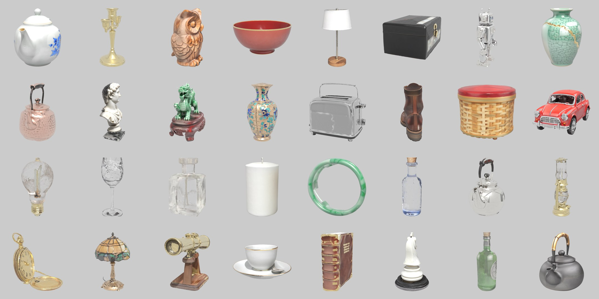
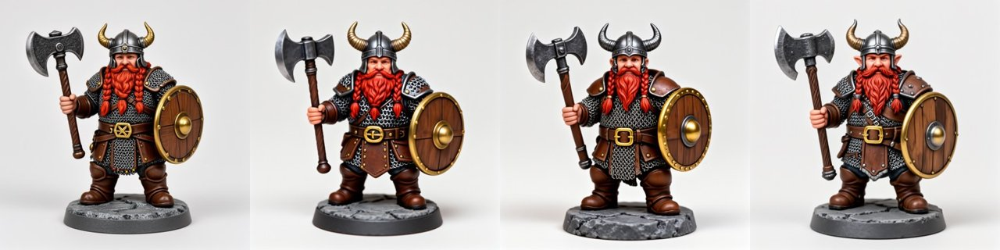
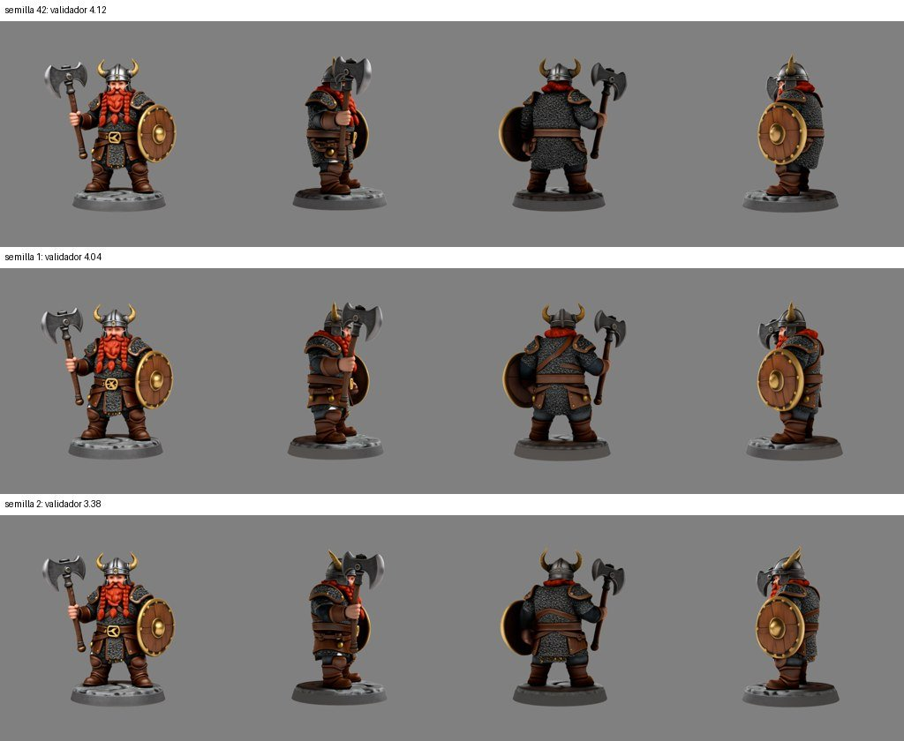
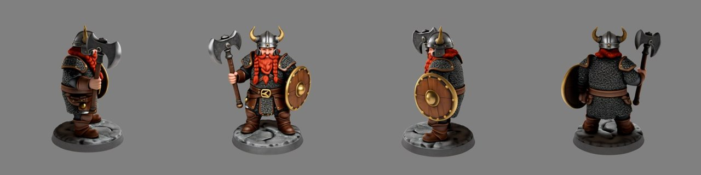
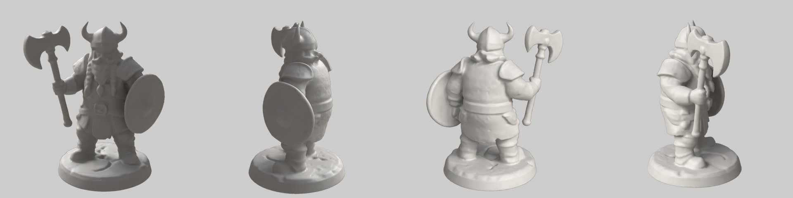
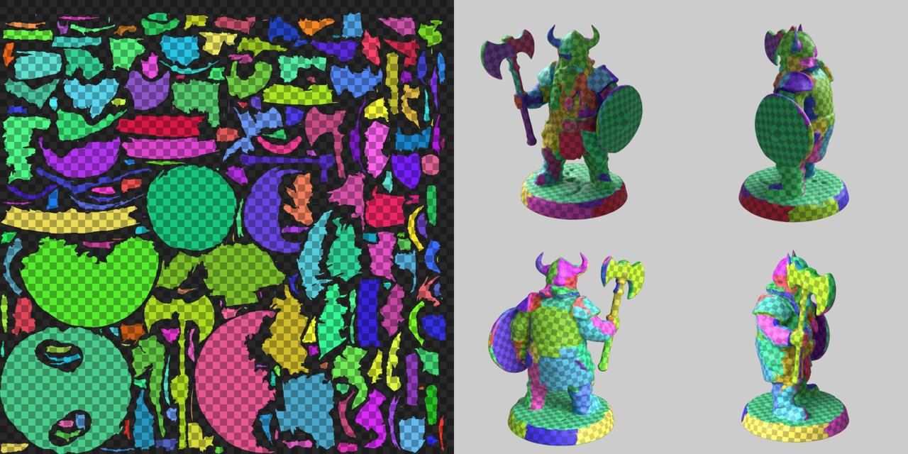
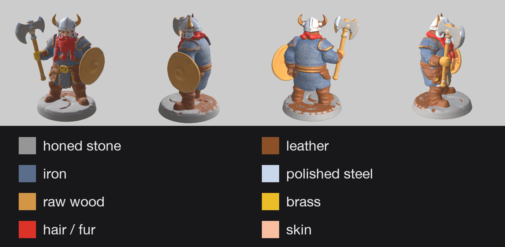
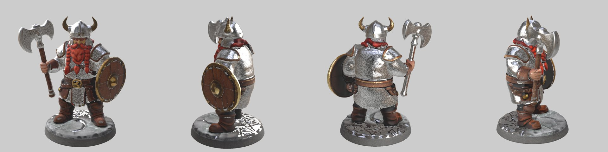
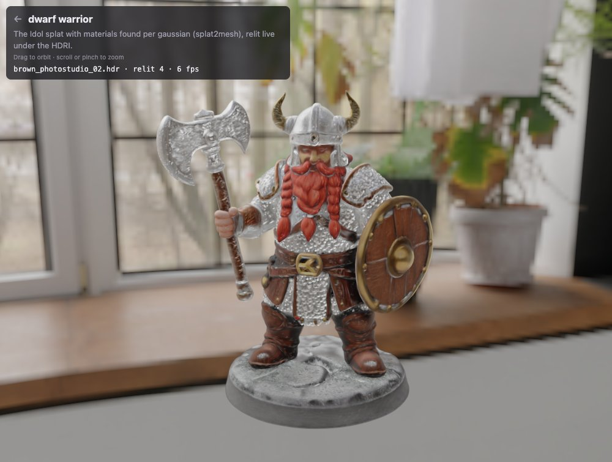

# splat2mesh

**3D Gaussian splat → production USD: a closed mesh, clean UVs, a baked texture and PBR materials, with no manual
step.** Give it a picture of an object (or a 3DGS `.ply`) and it returns a `UsdGeomMesh` with `UsdPreviewSurface`
and MaterialX materials, ready for usdview, Blender, Omniverse, Houdini or iPhone AR Quick Look.



*33 test objects (porcelain, metals, wood, lacquer, stone, jade, wax, glass, leather and mixes), each made from one
generated picture. Geometry, UVs, texture and materials are all automatic. Path traced under a studio HDRI.*
Live gallery (USDZ in the browser and in AR): <https://splat2mesh.lucab.co.uk>

```
picture ──Idol──▶ 3D Gaussian splat ──splat2mesh──▶ closed mesh + UVs + texture ──materials──▶ USD (PBR)
                  (speridlabs)                      (this repository)              Qwen3-VL + ENEAS + library
```

## Tutorial: a character from one sentence

The whole chain on one object, a painted dwarf-warrior figurine (an original design), from a text prompt to a
path-traced turntable. Every step is a command; nothing is touched by hand. Times are from an RTX 3070 (Idol,
ENEAS) and an Apple Silicon Mac (Iris, athenea, everything else).

### 1. Text → picture (Iris-3B Turbo, ~45 s per picture)

```sh
P="A painted fantasy miniature figurine of a stout dwarf warrior: long braided red beard, horned steel helmet, \
chainmail shirt under brown leather armour, gold belt buckle, holding a double-bladed steel battle axe and a round \
wooden shield with a brass rim, standing on a round grey stone base, whole figure centred, full body, studio \
product photo, soft even light, plain white background"
for s in 3 7 11 21; do
  bash $SPLAT2MESH_GPU_LOCK third_party/iris-3b/.venv/bin/python scripts/iris_local.py "$P" dwarf/s$s.png --seed $s
done
```



The first one is used. A white background matters: Idol borrows the background's colour for the sides it invents.

### 2. Picture → splat, four seeds, the best one kept (Idol, ~3.5 min per seed)

Idol invents the back from the front, and every seed invents it differently. On the Idol host:

```sh
for s in 42 1 2 3; do python -m idol.sample --image dwarf.png --seed $s --num_gaussians 524288 --out seeds/s$s; done
```

Each sample is rendered from its own predicted camera and from 90°, 180° and 270° around it (athenea), and a vision
model scores it against the picture ([multiview.md](docs/multiview.md)):

```sh
scripts/seed_views.sh seeds/s42/dwarf.ply seeds/s42/dwarf_camera.json dwarf.png checks/s42    # → checks/s42.check.json
```



Seed 42 scored 4.12 (the axe slightly flat), seed 1 4.04, seeds 2 and 3 3.38 (the shield flips side between views,
the beard shows from behind). Seed 42 is kept. `splat2usd.py --seeds 4` does the sampling, the four-side renders, the scoring and the choice in
one command. The kept splat, rendered with athenea:



### 3. Splat → mesh, UVs, texture, materials (one command)

```sh
mkdir -p src/00 && cp seeds/s42/dwarf.ply src/00/00.ply && cp seeds/s42/dwarf_input.png src/00/idol_input.png
cp seeds/s42/dwarf_camera.json src/00/idol_camera.json && echo "$P" > prompts.txt
.venv/bin/python scripts/flow_batch.py src out prompts.txt --gs
```

**Mesh** (direct mode, 2 min): 80 000 faces, one closed shell, 0 open and 0 non-manifold edges, 11 folded edges
(far below the 300 that would send it to the render path). Shown as plain clay with athenea:



**UVs**: 246 islands in a 4096² atlas, 56 % of it used. Checked with a texture that gives every island its own
colour and a checker on top (even squares = little stretch):

```sh
.venv/bin/python scripts/uv_islands.py out/00/usd
START_DEG=97 bash scripts/hdri_turntable.sh out/00/usd/uv.usda uv.mp4 4
```



**Materials** (`--gs`, [materials.md](docs/materials.md)):

1. DeepSeek looks at the picture and writes the parts by material with the library's names; the prompt corrects
   single parts it names ("grey **stone** base").
2. The splat is rendered with athenea on 16 views; ENEAS finds and tracks each part, starting from the view that
   matches Idol's camera for the picture.
3. DeepSeek checks every mask; overlaps are settled by reliable masks and by colour clusters it names.
4. Every gaussian votes for the part its pixel shows (88 % of them are seen directly), and every texel inherits the
   votes of its nearest gaussians.
5. Library values (roughness, metallic, IOR, subsurface…) and the finish pass give the maps.

DeepSeek's part list for the dwarf: stone base; leather armour and boots; iron chainmail; polished-steel helmet and
axe blade; wooden shield and axe handle; brass shield rim and helmet horns; braided beard (hair); face and hands
(skin). Each colour is one material:



The splat with its materials is also written back (`mat/splat_materials.ply`: material, roughness, metallic,
transmission, IOR and albedo per gaussian). Known flaw here: some leather leaks onto the back of the base, on the
side Idol invented.

### 4. Render

```sh
.venv/bin/python -m splat2mesh.athenea turntable out/00/usd/asset.usda dwarf.mp4 --frames 96 --start-deg 97
```

athenea renders all 96 frames in one process (one scene load, about five minutes for 1080² frames) under the studio
HDRI, raster with the prefiltered dome (`--technique rt` path traces), and composites them on grey.



### 5. The splat itself, relit (no mesh)

The materials live on the gaussians too, so the splat can be relit without any geometry: exported to athenea's USD
(`python -m splat2mesh.athenea_splat … --y-down`) it renders relit in athenea, and converted to `.athc` it is relit
live in the browser by athenea's code in Spark WebGPU ([web/README.md](web/README.md)):



Live: <https://splat2mesh.lucab.co.uk> (first card; WebGPU browser).

The video for posting is put together from the same shots with `scripts/make_video.py`.

## What it does

| Stage | How | Typical result |
|---|---|---|
| Picture → splat | [Idol](https://github.com/speridlabs/idol-sdk) (speridlabs) on a CUDA machine | 262 144–524 288 gaussians, ~3 min on an 8 GB GPU |
| Splat → mesh, **direct mode** | the splat's opacity field on a 448³ grid → solid → marching cubes → topology-preserving decimation | one watertight shell, 80 000 faces, ~1 min |
| Splat → mesh, **render path** | 87 rendered RGB-D views → TSDF fusion + visual hull | for splats that direct mode crumples; ~10 min |
| UVs + texture | xatlas, then colour baked from the gaussians (or the views) into a 4096² atlas | ~100–250 charts |
| Materials | parts named by Qwen3-VL, tracked on 16 views by [ENEAS](https://github.com/speridlabs/eneas), voted per texel, values from a 60-entry PBR library | roughness, metallic, transmission, subsurface maps |
| Output | USD with `UsdPreviewSurface` + MaterialX `standard_surface`; per-part and per-material variants | QA report: open and non-manifold edges, folds; PSNR vs the splat on the render path |

## Quick start

```sh
git clone https://github.com/jesusluque/splat2mesh.git && cd splat2mesh
uv venv --python 3.12 .venv && uv pip install --python .venv/bin/python -r requirements.txt
.venv/bin/python tests/synthetic.py      # end-to-end check on a procedural object, CPU only, ~40 s
```

From a splat you already have (CPU only):

```sh
.venv/bin/python scripts/splat2usd.py my_object.ply --direct --out out/demo   # --y-down for COLMAP/Idol .ply
```

Machine-specific settings (renderer, GPU hosts, DeepSeek key) live in one file: copy
`splat2mesh.example.toml` to `splat2mesh.toml` and see [docs/setup.md](docs/setup.md). The renderer, athenea, is a
submodule: `git submodule update --init third_party/athenea`, then build it as described there.

From a picture (needs Idol, locally or on a CUDA host reachable by ssh):

```sh
.venv/bin/python scripts/splat2usd.py lucky_cat.png --direct --out out/demo
```

Result: `out/demo/<name>/usd/asset.usda` with its textures and `report.json` (the render path, without `--direct`,
also writes `compare.png`, splat beside mesh, and a re-render PSNR).

## Documentation

| | |
|---|---|
| [Tutorial: basics](docs/TUTORIAL_basics.md) | one object step by step: picture → splat → USD, the UV map, direct mode vs render path |
| [Tutorial: materials](docs/TUTORIAL.md) | the full chain with automatic PBR materials, parts for compositing, web and video |
| [Pipeline reference](docs/pipeline.md) | every stage, its parameters and the reasons behind the defaults |
| [Materials reference](docs/materials.md) | how parts are found, the per-texel rules, the material library, glass |
| [Multi-view and seed selection](docs/multiview.md) | more than one view of the object; choosing the best Idol sample with a vision validator |
| [Setup](docs/setup.md) | dependencies, GPU hosts, environment variables |
| [Scripts](docs/scripts.md) | what every script does, grouped by purpose |
| [Findings](docs/findings.md) | what was tried, measured, kept and dropped, with numbers |
| [Licences](docs/licenses.md) | licences of the code, the dependencies and the models |

## Status and limits

splat2mesh is research code. It runs end to end on five test sets of eight generated pictures, and 33 of the
results are in the gallery. Known limits (details in [findings](docs/findings.md)):

- Idol invents the sides the picture does not show; those sides are only as good as Idol's guess.
- Direct mode makes solids: a vase has no inside, a bottle no liquid surface.
- Glass is hard for any splat. Glass that the splat leaves as an opening, and opaque parts inside glass (filaments,
  wicks), are recovered by dedicated stages, but refraction stays baked into the colour.
- Small parts (corks, eyelids, thin wires) are often missed by the segmenter.
- The GPU stages were developed on specific machines (an RTX 3070 Windows host for Idol and ENEAS, an Apple Silicon
  Mac for Iris and rendering); they are reached through ssh and environment variables, not packaged.

## Licence

splat2mesh is Apache-2.0 (see [LICENSE](LICENSE) and [NOTICE](NOTICE)). Its Python dependencies are permissive.
The models it calls have their own licences; **one of Idol's image encoders, as Idol loads it by default, comes from
a non-commercial repository**. Read [docs/licenses.md](docs/licenses.md) before any commercial use.

## Credits

Idol, Iris-3B and ENEAS are by [speridlabs](https://github.com/speridlabs). Qwen3-VL-4B by the Qwen team. xatlas,
Open3D, trimesh, fast-simplification, manifold3d and OpenUSD do the geometry and file work. HDRIs from Poly Haven
(CC0).
