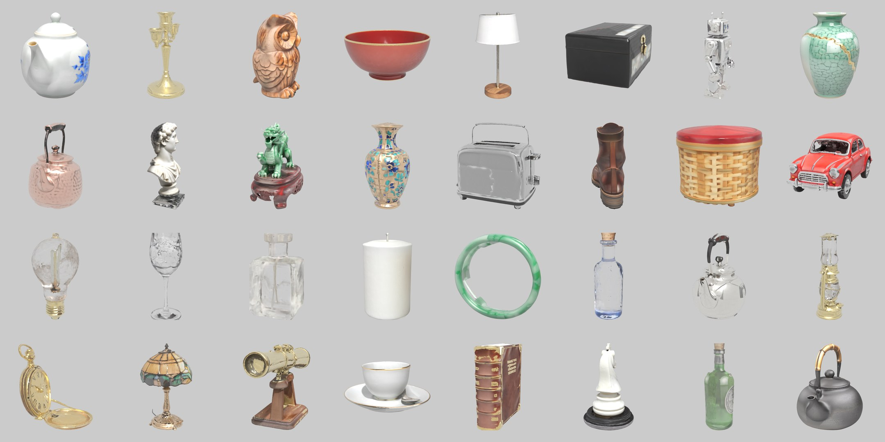
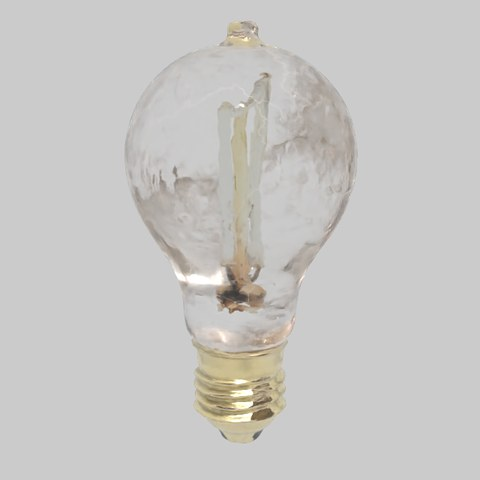
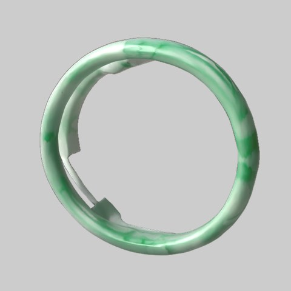

# Tutorial: from an image (or a text prompt) to a production USD with PBR materials

splat2mesh turns a 3D Gaussian splat into a **UV-textured USD mesh with physically based materials**, fully
automatically. The whole chain runs on open models:

```
text ──Iris-3B──▶ image ──Idol──▶ 3D Gaussian splat ──splat2mesh──▶ HD mesh + UVs + texture
                                                                    │
         Qwen3-VL: "gold: the coin; porcelain: the body…" ◀─────────┤  (which parts, which material)
         ENEAS: tracks each part on a 16-view orbit     ◀───────────┤  (where each part is, in 3D)
         material library: roughness, metallic, IOR, F0, SSS ──────▶ USD (UsdPreviewSurface + MaterialX)
                                                                       + one Mesh per part (Cryptomatte)
```



*32 test objects generated overnight — porcelain, metals, wood, lacquer, stone, jade, wax, glass, leather and
mixes — every material assigned by the pipeline, no manual step. Path traced with athenea.*

The step-by-step basics (direct mode, the UV map, the render path) are in [TUTORIAL_basics.md](TUTORIAL_basics.md).

## 1. Install

```sh
git clone https://github.com/jesusluque/splat2mesh.git && cd splat2mesh
uv venv --python 3.12 .venv
uv pip install --python .venv/bin/python -r requirements.txt
.venv/bin/python tests/synthetic.py            # end-to-end check, no GPU
```

GPU pieces (each optional; the pipeline tells you which one it needs):

| Piece | What for | Where it ran here |
|---|---|---|
| [Idol](https://github.com/speridlabs/idol-sdk) (speridlabs) | image → 3D Gaussian splat | CUDA, 8 GB (RTX 3070) or 24 GB (L4) |
| [Iris-3B](https://github.com/speridlabs/iris-3b) (speridlabs) | text → image; its text encoder **Qwen3-VL-4B** describes materials | Apple M5 Pro (MPS, bf16, 16 GB) |
| [ENEAS](https://github.com/speridlabs/eneas) (speridlabs) | text → part masks tracked across views | CUDA in WSL / Linux (L4) |
| athenea | renders the splat views (render path) and the turntable videos | Metal |

Hosts are environment variables: `SPLAT2MESH_IDOL_HOST`, `SPLAT2MESH_ENEAS_HOST` (+ `SPLAT2MESH_*_LINUX=1` for
plain Linux), `ATHENEA_BUILD`.

## 2. One object, one command

```sh
.venv/bin/python scripts/splat2usd.py lucky_cat.png --direct --gaussians 524288 --out out/demo
```

1. **Idol** turns the picture into a splat (it invents the hidden sides — use a white background).
2. **Direct mode** builds the mesh straight from the gaussians: opacity field on a 448³ grid → solid (gaps closed,
   cavities filled) → marching cubes → topology-preserving decimation to **80 000 faces**, one closed shell.
3. If the surface comes out crumpled (> 500 folded edges: black lacquer walls, faceted glass), it **falls back
   automatically to the render path**: athenea renders 87 views, TSDF fusion + visual hull.
4. **xatlas** UVs, colour baked from the gaussians into a **4096²** atlas.

## 3. Materials, automatically

```sh
.venv/bin/python scripts/flow_batch.py out/demo out/demo_pbr prompts.txt     # a folder of objects
```

For every object:

1. **Qwen3-VL describes** the parts by material, using the library's names, from the image and the Iris prompt:
   `glass: the bulb; brass: the screw base`.
2. **The prompt is the authority on which material** within a family: "gold" becomes "brass" when the prompt says
   brass; a family the prompt never mentions is replaced by the prompt's unused material (a "porcelain" bowl that
   the prompt calls urushi lacquer becomes lacquer).
3. **ENEAS tracks every part** on a 16-view orbit of the textured mesh, grounded on the view that matches the input
   picture. Masks are back-projected to texels and voted.
4. **Sanity rules** catch the segmenter's mistakes: a secondary part covering most of the object is dropped; thin
   parts (rim, wire, hinge, cap…) may not exceed 15 %; a secondary transparent part may not exceed 25 %
   (a watch crystal must not turn the dial into glass).
5. **Borders follow colour edges**: each colour region only admits the materials that hold a real share of its votes,
   so a mask that spills over white porcelain cannot make it gold.
6. **Colour priors** recover thin parts the segmenter misses: kintsugi lines and gilt rims (F0 hue), chrome
   bumpers (bright grey), rubber tyres (near black).
7. **The library** (`splat2mesh/material_library.json`, 58 entries) gives roughness, metallic, IOR, metal F0 colour,
   transmission and subsurface.

8. **Finish pass**, so glossy pieces look finished rather than scanned:
   - *shading normals* come from a smoothed copy of the mesh (positions untouched), so reflections on porcelain,
     lacquer and polished metal flow instead of showing the fused surface's small bumps;
   - *metals* take the physical F0 colour times only the **fine** detail of the baked texture (high-pass of
     log-luminance): hammering and engraving stay, frozen reflections go;
   - *the side Idol invented* (whatever the input picture did not show) is lifted to the brightness of the same
     material on the seen side when it came out much darker (dark backs, black bases);
   - *glass, crystal, jade and wax* objects get their vertex positions smoothed as well.

What lands in the USD:

| Map | Source |
|---|---|
| base colour | the baked splat colour; **polished metals use the physical F0 colour** (the splat's colour is frozen reflections); glass gets a uniform tint |
| roughness, metallic | library, per texel |
| transmission, subsurface | library (glass, crystal; jade, wax, marble, porcelain) |
| opacity, IOR | for `UsdPreviewSurface` viewers |

Two surfaces per material: `UsdPreviewSurface` (every viewer) and a **MaterialX `standard_surface`** with
transmission and subsurface (athenea, Karma, Arnold…).

 

## 4. Parts for compositing (Cryptomatte)

Next to `asset.usda` the flow writes:

- `asset_parts.usda` — one `Mesh` per part (`/Asset/Parts/gold_bell`, `/Asset/Parts/red_collar`…), each with its own
  material. Renderers that build CryptoObject from the prim path (athenea) give one matte per part.
- `asset_materials.usda` — one `Mesh` per material (`/Asset/MaterialGroups/gold`…): one matte per material.

## 5. Viewing and sharing

- **Web**: `scripts/export_web.py` builds a USD-only gallery: each card shows a path-traced still and loads the USDZ
  only when clicked (three.js `USDZLoader`, four switchable CC0 HDRIs, at most four live viewers). The web copy is the
  per-part USD; a small JSON per model lets the viewer turn glass parts into a physical transmission material and
  jade/wax into a translucent one, which `UsdPreviewSurface` cannot express. iPhone opens the same USDZ in AR.
  Live: <https://splat2mesh.lucab.co.uk>.
- **Video**: `scripts/athenea_turntable.sh asset.usda out.mp4` path traces a turntable with athenea, frame by frame,
  and encodes it with ffmpeg.

## 6. What still goes wrong

- Idol paints what it cannot see: dark undersides, refraction baked as colour on glass.
- Direct mode fills solids: a light bulb is solid glass, a vase has no inside.
- Parts below a few pixels (filaments, eyelids, corks) are often missed; colour priors only cover metals and rubber.
- A part the segmenter misses and that is not a metal or rubber (a rosewood stand under jade) takes the main material.
- Library values are catalogue values, not measurements. Qwen3-VL's own PBR numbers were stereotyped and unstable,
  so they are not used.

The full log of what was tried and measured is in `LOOP.md`.
