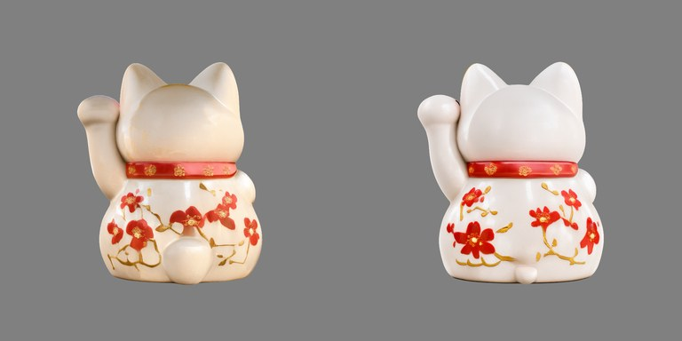
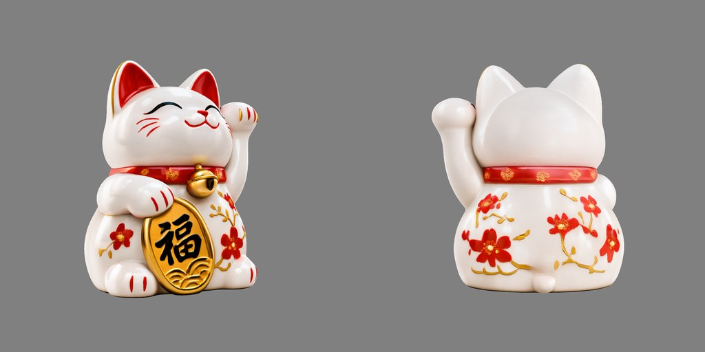
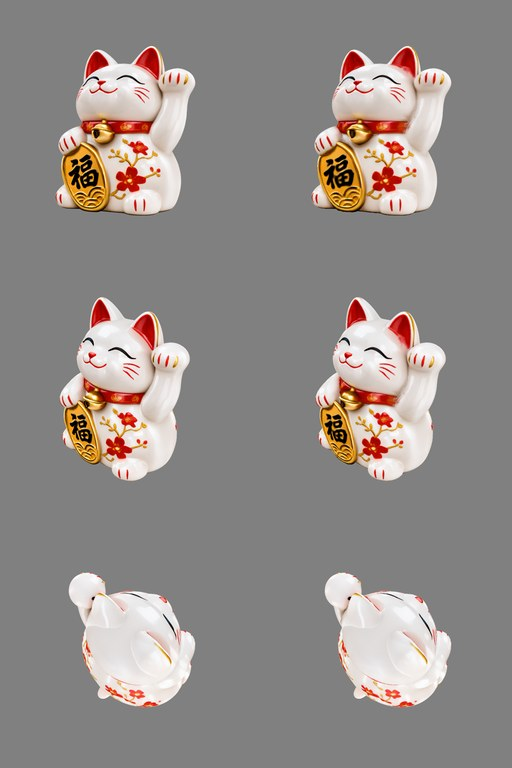
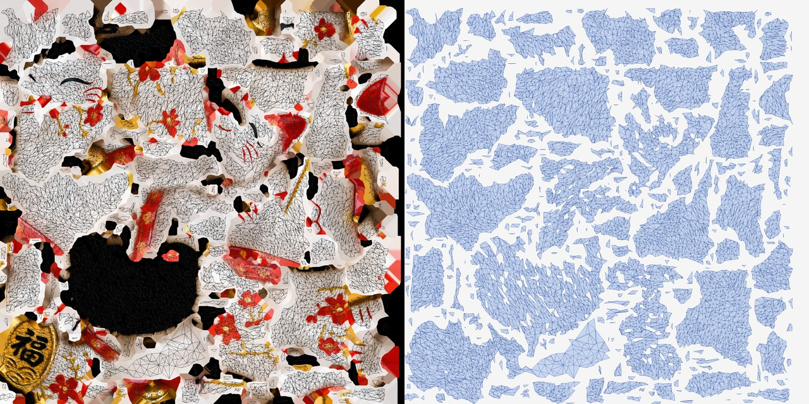
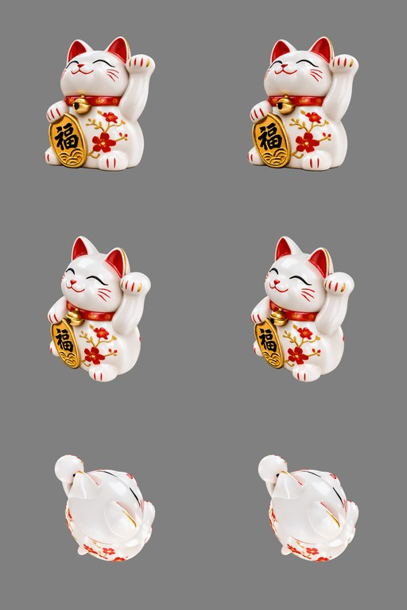
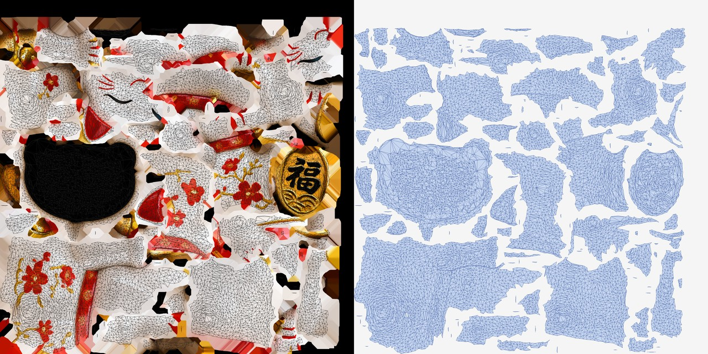

# Tutorial: from an image (or a text prompt) to a UV-textured USD

Result of this tutorial: a 20 030-face USD with UVs, 0 open edges, 0 non-manifold edges, in about 12 min.

A fully open chain, every model and tool permissively licensed:

```
text ──Iris-3B Turbo──▶ image ──Idol──▶ 3D Gaussian splat ──splat2mesh──▶ USD mesh + UV + texture
     (speridlabs)               (speridlabs)                 (this repo)
```

You can also enter the chain with your own image or with an existing 3DGS `.ply`.

## 1. Install

```sh
git clone https://github.com/jesusluque/splat2mesh.git && cd splat2mesh
uv venv --python 3.12 .venv
uv pip install --python .venv/bin/python -r requirements.txt gradio_client
```

## 2. Check it works (no GPU)

```sh
.venv/bin/python tests/synthetic.py
```

It builds a torus and a sphere with procedural colours, "photographs" them from 80 cameras and converts
them. It takes about 40 s and should print something like:

```json
"faces": 19998, "boundary_edges": 0, "non_manifold_edges": 0,
"chamfer_mean": 0.0023, "texture_psnr_db": 27.4
```

`chamfer_mean` is the shape error against the true geometry (here ≈ 0.25 % of the object size);
`texture_psnr_db` is how well the colour comes out.

## 3. Get an image

Any picture of **one object, whole, centred, on a plain white or light-grey background** works. This
tutorial uses a lucky-cat figurine made with an image generator:


To make one from text with Iris-3B Turbo (speridlabs, Apache-2.0):

```sh
.venv/bin/python scripts/text2image.py \
  "A glossy white ceramic maneki-neko lucky cat figurine raising its paw, red collar with a gold bell, \
holding a gold koban coin, cherry blossom painting, whole object centred, studio product photo, \
plain white background" lucky_cat.png --seed 7
```

The script uses the public Iris-3B Turbo Space; set `HF_TOKEN` for more quota, or run Iris-3B locally
(see [speridlabs/iris-3b](https://github.com/speridlabs/iris-3b)).

**Use a white background.** Idol invents the sides the picture never showed, and it borrows colour from
the background. The same cat on a black background (left) and on a white one (right), seen from behind:



With the white background the back is cleaner and whiter, and the mesh came out with no defects at all.

## 4. Image → splat → USD, in one command

```sh
.venv/bin/python scripts/splat2usd.py lucky_cat.png --gaussians 524288 --out out/tutorial
```

What happens:

1. **Idol** turns the image into a 3D Gaussian splat on a CUDA machine (`SPLAT2MESH_IDOL_HOST`), ~3 min on
   an 8 GB laptop GPU.
2. The splat is rendered from **87 cameras** around it, with colour, mask and depth (~6 min).
3. The depth maps are fused into a surface, cleaned, reduced to 20 000 faces and closed.
4. **xatlas** unwraps the UVs; the colour of every view is baked into one texture.
5. A **USD** is written with `UsdPreviewSurface`, and a QA pass compares the mesh with the splat.

The splat from two views the input image never had, three-quarter (left) and back (right):



Left, the splat; right, the textured mesh, from three of the cameras:



### The UV map

Left, the baked 2048² texture with the triangle outlines; right, the UV layout on its own:



- **243 charts** fill **56 %** of the atlas; xatlas packs them without overlaps, with 4 texels of padding.
- Each chart is a patch of surface that unfolds with little stretching; seams run between charts.
- The large black chart is the **underside** of the cat: Idol generates the base in black and the bake
  copies what the splat shows. The face, the 福 coin, the collar and the flowers are each in one or two
  charts, so they keep their detail.
- These UVs are made for baking, not for hand painting: for artist-clean UVs remesh to quads first.

Result for this cat: **20 030 faces, 0 open edges, 0 non-manifold edges, PSNR 24.1 dB, 11.7 min** end to end
(Idol 2.9 min, render 5.7 min, mesh + UV + bake + USD 3.1 min). The PSNR is lower than on matte objects
because the porcelain highlights change with the view and a texture holds one fixed colour.

Already have a splat? Start here instead:

```sh
.venv/bin/python scripts/splat2usd.py my_object.ply --out out/tutorial    # add --y-down for COLMAP-style .ply
```

A whole folder of images and `.ply` files is a batch: `splat2usd.py my_folder/ --out out/batch`.

## 4b. Fast mode: `--direct` (no rendering)

```sh
.venv/bin/python scripts/splat2usd.py lucky_cat.png --direct --gaussians 524288 --out out/tutorial
```

Instead of photographing the splat from 87 cameras, `--direct` builds the mesh **straight from the gaussians**:

1. Every gaussian adds its opacity to a 3D grid (≈ 320 cells across the object): `O(x) = 1 − Π(1 − αᵢ·Gᵢ(x))`.
2. The solid is where the opacity passes 0.3; small gaps between gaussians are closed, hollow insides are
   filled and loose specks are dropped, so the result is **one closed shell**.
3. Marching cubes gives the surface; a topology-preserving quadric decimation brings it to 20 000 faces
   without breaking it apart.
4. Each texel of the UV atlas takes the colour of the gaussians right at the surface, weighted by how much
   they cover that point (gaussians buried inside barely count).

Same cat, left the splat, right the `--direct` mesh:



And its UV map (texture with triangle outlines, and the layout on its own):



The direct mesh is smoother and cleaner, so xatlas cuts it into far fewer, larger charts: the face, the 福
coin and the flank flowers each sit in one chart. The black chart is again the underside that Idol leaves dark.

| Same splat | render path (default) | `--direct` |
|---|---|---|
| Time after Idol | ~9 min | **~40 s** |
| Components / non-manifold / open edges | 1 / 0 / 0 | **1 / 0 / 0, watertight** |
| UV charts | 243 | **108** |
| PSNR vs the splat | 24.1 dB | **27.1 dB** |

Use `--direct` for splats made by Idol (gaussians with volume). For thin, surface-aligned splats, such as
ones converted from meshes or some photogrammetry captures, keep the render path: there the opacity field
has holes that `--direct` cannot close.

## 5. What you get

```
out/tutorial/lucky_cat/
├── report.json          ← measurements and timings; "ok": true/false
├── render/              ← the 87 views of the splat (colour, mask, depth, cameras)
└── usd/
    ├── asset.usda       ← the mesh with UVs and material (usdview, Blender, Omniverse…)
    ├── basecolor.png    ← the texture
    ├── mesh.ply
    └── compare.png      ← splat vs textured mesh
```

Reading `report.json`:

| Field | Meaning | Good |
|---|---|---|
| `mesh.boundary_edges` | open edges (holes) | 0 |
| `mesh.non_manifold_edges` | edges shared by more than 2 faces | ≤ 20 |
| `mesh.uv_charts` | UV islands | fewer is better |
| `qa.psnr_mean` | how close the textured mesh looks to the splat, dB | ≥ 22 (26–30 is very good) |
| `t_total_s` | total time | |

Always look at `compare.png`: it is the quickest way to spot a problem.

## 6. Useful options

| Option | What for |
|---|---|
| `--faces 50000` | more geometric detail (default 20 000) |
| `--tex 4096` | bigger texture (default 2048) |
| `--smooth 3` | smoother surface; recommended for glass, slightly less accurate on opaque objects |
| `--min-psnr 25` | stricter threshold for "ok" |
| `--notify` | send the summary and images when a batch ends |

## 7. Glass

A splat does not know an object is transparent: it paints what shows through as colour. Given views of
the object in front of a known background (a checker, for instance), the tool estimates the material:

```sh
.venv/bin/python scripts/glass_estimate.py out/tutorial/vase/usd views_with_background/ background.json --apply
```

It finds the index of refraction and the tint by tracing refracted rays through the mesh to the
background, and turns the USD material into glass. `background.json` describes the background as one or
more textured planes (see `splat2mesh/glass.py`). Check it with `tests/glass_selftest.py`.

## 8. When something goes wrong

- **`"ok": false` with an `error`**: the message names the step (Idol, render, mesh).
- **Object upside down in `compare.png`**: rerun with `--y-down` (or `--y-up` for an Idol splat that is already upright).
- **Low PSNR on shiny objects**: expected; the texture is one fixed colour and cannot reproduce
  reflections that change with the viewing angle.
- **Many UV islands**: try `--smooth 1`; artist-clean UVs need quad remeshing.

The input image of this tutorial was made with an image generator; every other image comes from Idol and splat2mesh.
