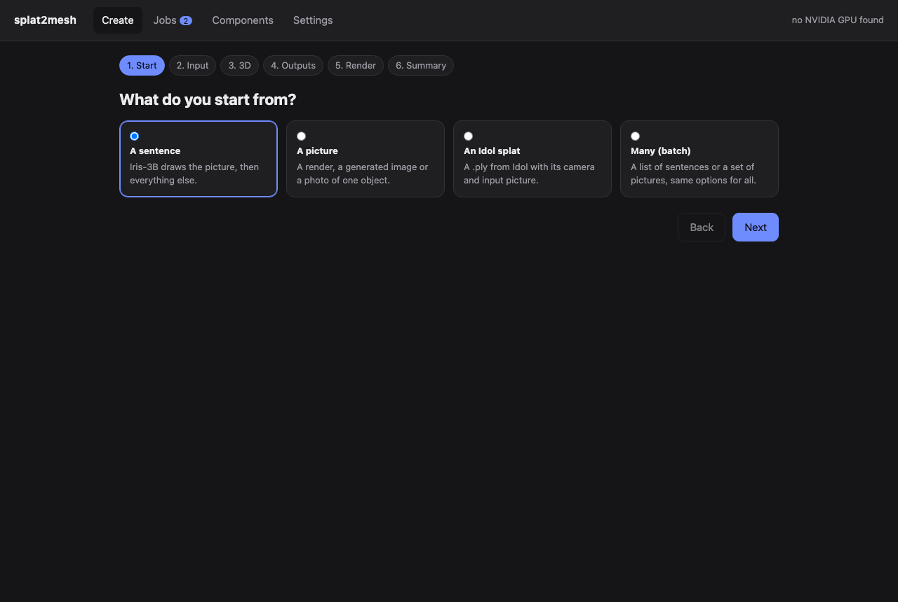
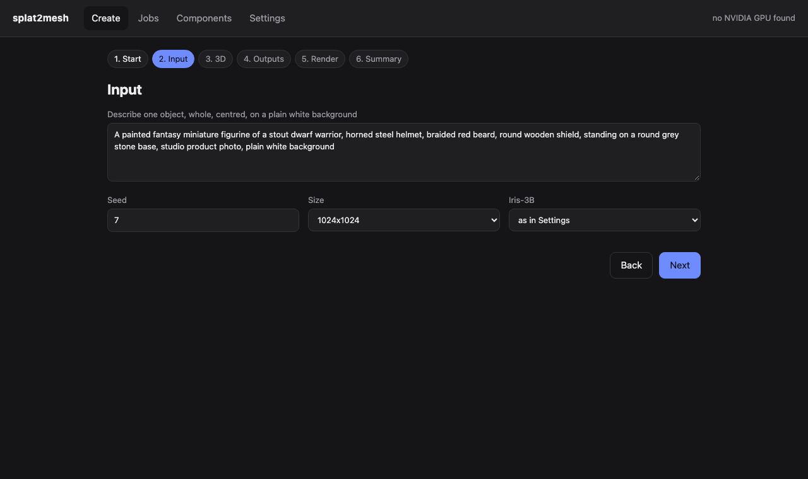
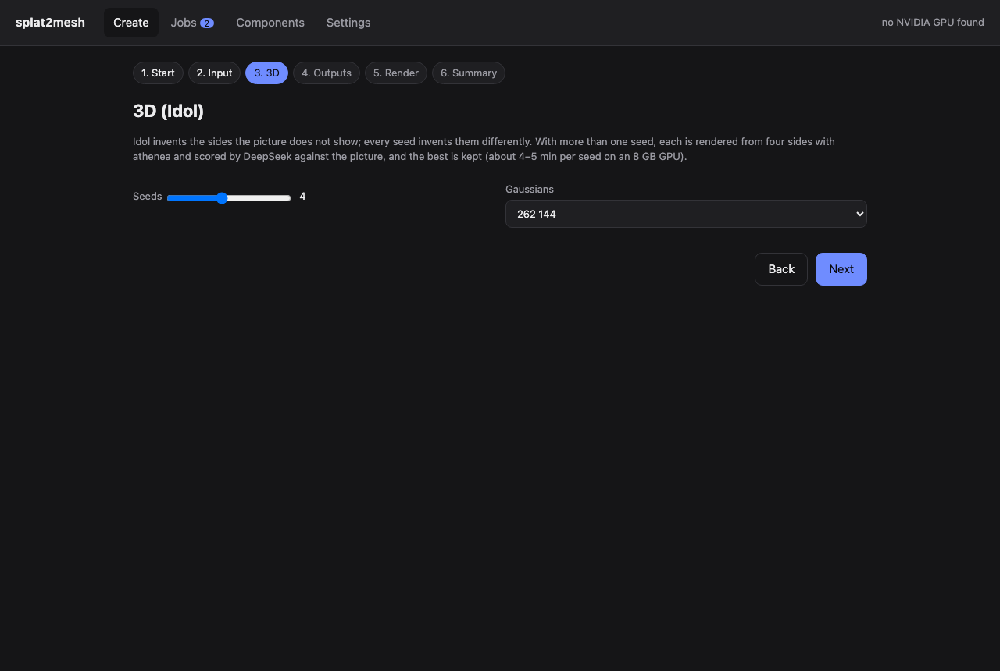
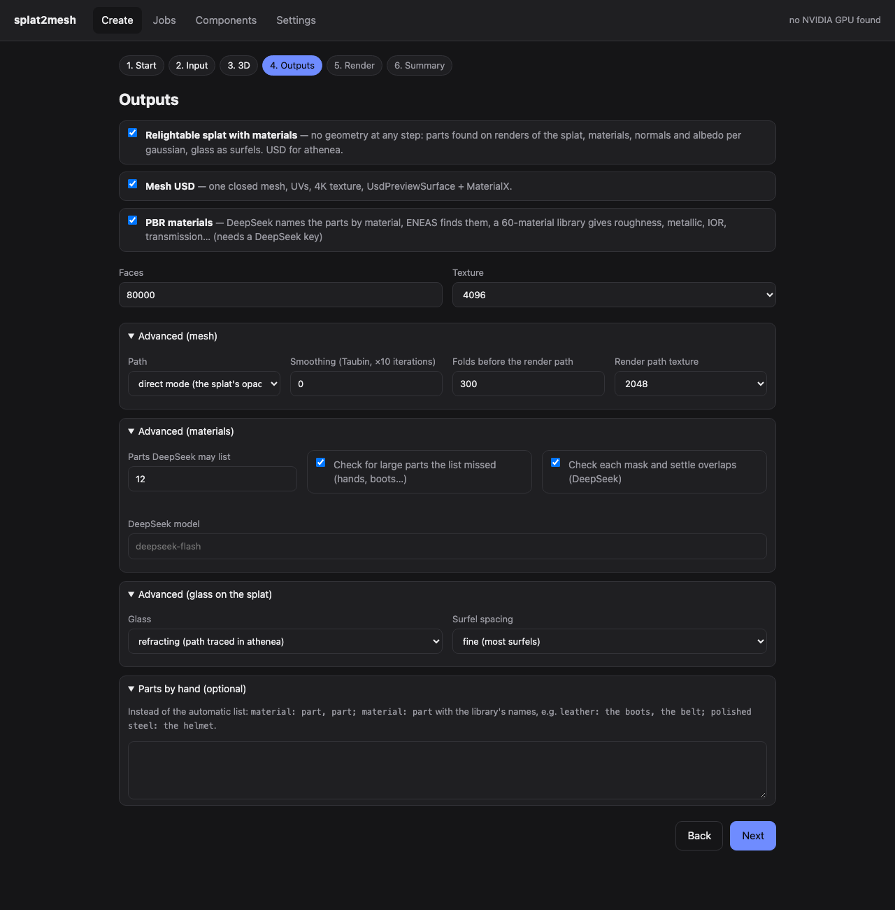
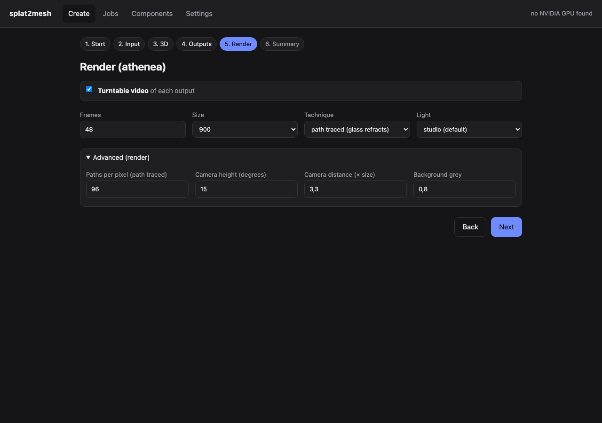
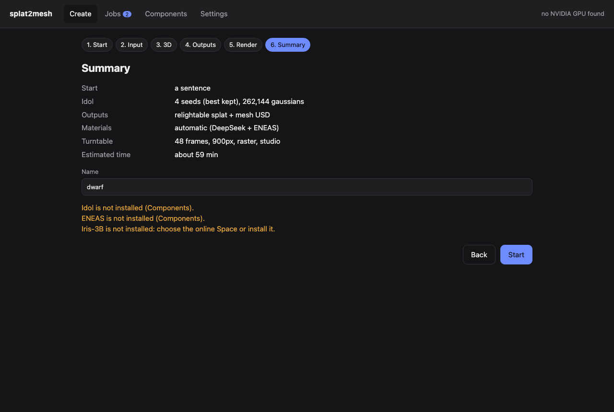
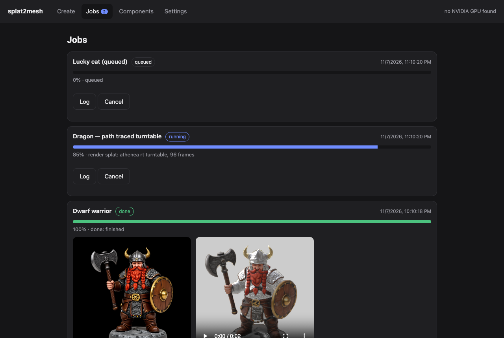
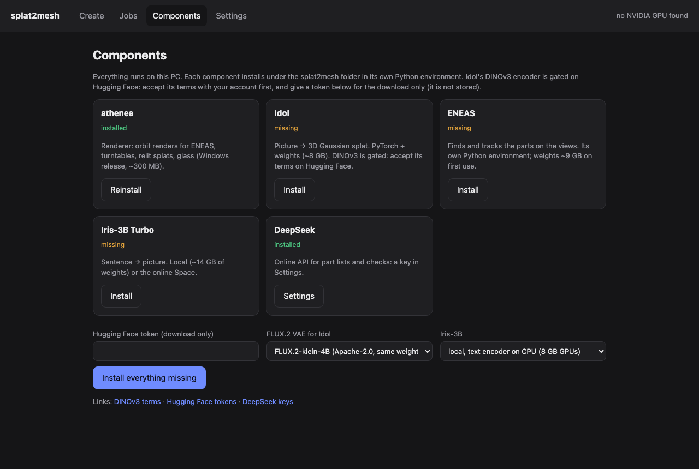
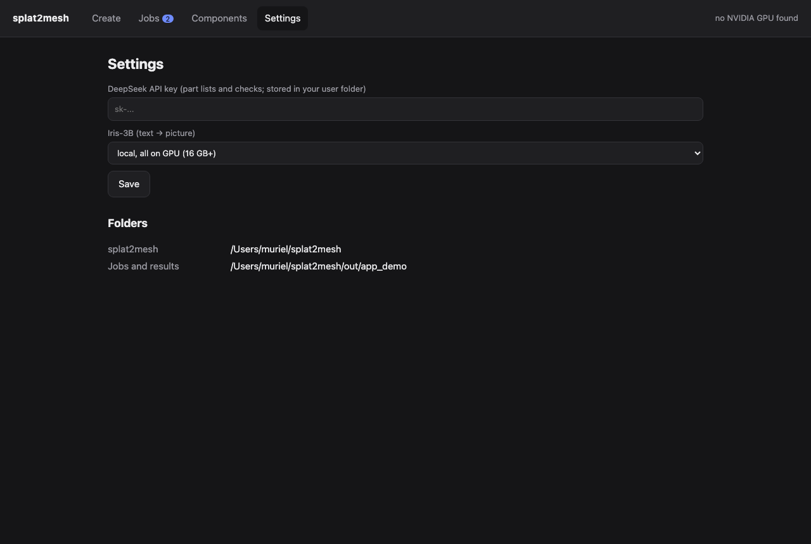

# The splat2mesh app

A local app that drives the whole pipeline: a wizard for one object or a batch, a job queue with progress bars,
the components and the settings. It runs on Windows, macOS and Linux; on Windows the installer sets everything up
([windows.md](windows.md)).

```sh
python -m splat2mesh.app                 # http://127.0.0.1:8765, opened in its own window
python -m splat2mesh.app --port 9000 --work D:\splat2mesh-results --no-browser
```

It only listens on 127.0.0.1. Jobs run one at a time (there is one GPU) as separate processes; closing the window
does not stop them, and the queue survives a restart of the app (an interrupted job is marked as such).

## Create: the wizard

Six steps; the bar at the top jumps to any of them.

**1. Start** — a sentence (Iris-3B draws the picture), a picture, an Idol splat, or many objects at once.



**2. Input** — the sentence, with Iris-3B's seed, size and where it runs (local with the text encoder on the CPU
for 8 GB GPUs, all on the GPU, or the online Space). For a picture, the file (.png for renders and generated
pictures, .jpg for photos: Idol frames them differently); for a splat, the .ply with Idol's camera and input
picture. A batch takes one sentence per line, or several pictures.

Iris-3B Turbo was distilled at about one megapixel in seven aspect buckets (1024×1024, 896×1200, 896×1344,
752×1344 and their landscape transposes); larger sizes lose quality. The most detail Idol can get is therefore the
object filling the frame in the bucket of its shape: a tall object in 896×1200 gets about 40 % more pixels than at
1024×1024 with the same prompt. **Fill the frame** (on by default) adds that request to the
sentence when it does not say it. An upscale alone does not help (Idol resizes it back to 1024 px); the detail
pass below does.



**Detail before Idol** (on by default for sentences and pictures). Idol works on a 1024 px picture, so an upscale
gives it nothing: the extra pixels are resized away. The detail pass (`scripts/detail_pass.py`) puts sharper detail
*inside the same pixels*: the whole picture goes through the Iris-3B restorer at 4× without being shrunk first and
comes back to its own size, then each face (found by DeepSeek) gets a second pass. Eyes, lashes, hair strands,
stitching, rivets and laces come out defined, and Idol keeps them: with the same seed, eyes come out open with
irises and eyebrows instead of smudged, and the shape from the side and the back is unchanged. Real-ESRGAN (BSD-3) and SwinIR-L (Apache-2.0) were tried as well
(`scripts/sr_upscale.py`, through spandrel): they left faces smooth, and the Iris restorer is used. About four
minutes; it needs Iris-3B installed locally (with its restorer, +12 GB).

**3. 3D** — Idol's seeds and the number of gaussians. With more than one seed, each sample is rendered from four
sides with athenea and scored by DeepSeek against the picture, and the best is kept
([multiview.md](multiview.md)).



**4. Outputs** — the relightable splat with materials (no geometry at any step), the mesh USD, the PBR materials
(DeepSeek names the parts, ENEAS finds them), the mesh's face count and texture size, and an optional part list by
hand (`material: part, part; …` with the library's names, [materials.md](materials.md)). When both outputs are
chosen the mesh reuses the splat's segmentation, so ENEAS runs once.



**5. Render** — a turntable video of each output with athenea: frames, size, raster (fast) or path traced (glass
refracts), and the light.



**6. Summary** — what will run, an estimate of the time on an 8 GB GPU, and a warning for anything missing (a
component not installed, no DeepSeek key, no output chosen).



## Jobs

Every job shows its stage and a progress bar (the stages are weighted by their usual time: Idol, materials,
mesh, renders), its log, and when it is done the input picture, the turntables, downloads of the USD and PLY
files and a button that opens the result folder. Queued and running jobs can be cancelled.



Results are in `<work>/jobs/<job>/out/`:

| File | What |
|---|---|
| `splat/splat.usdc` | the relightable splat for athenea (materials, normals, glass surfels) |
| `splat/mat/splat_materials.ply` | the splat with its material, roughness, metallic, IOR and albedo per gaussian |
| `mesh/00/usd/asset.usda` | the mesh: UVs, 4K texture, UsdPreviewSurface + MaterialX, parts as variants |
| `splat_turntable.mp4`, `mesh_turntable.mp4` | the turntables |
| `seeds.json`, `seeds/` | each Idol seed and its score, when there were several |
| `results.json`, `log.txt` | the outputs and the full log |

## Components

What is installed, the GPU, and an install or reinstall button for each component, with its own progress bar in
Jobs. Idol's DINOv3 encoder is gated on Hugging Face: accept its terms, then give a token here; it is used for that
download only and not stored. The FLUX.2 VAE comes from FLUX.2-klein-4B (Apache-2.0) unless FLUX.2-dev is chosen.



## Settings

The DeepSeek key (stored in the user's folder, `%APPDATA%\splat2mesh` on Windows) and where Iris-3B runs.



## For scripts

The app is a thin layer: everything it does is available from the command line.

| App | Command |
|---|---|
| a job | `python -m splat2mesh.app.pipeline JOB.json` (keys in its docstring); prints `PROGRESS <0-100> <stage>: <message>` |
| components | `python -m splat2mesh.winsetup status` / `install athenea idol eneas iris` |
| the HTTP API | `GET /api/status`, `GET/POST /api/jobs`, `GET /api/jobs/<id>?log=N`, `POST /api/jobs/<id>/cancel`, `POST /api/upload?name=`, `POST /api/settings`, `GET /api/file?path=` (inside the work folders only) |
| deep links | `/?source=prompt&step=outputs&prompt=...&seeds=4&mesh=1&technique=rt`, `/#jobs` |
