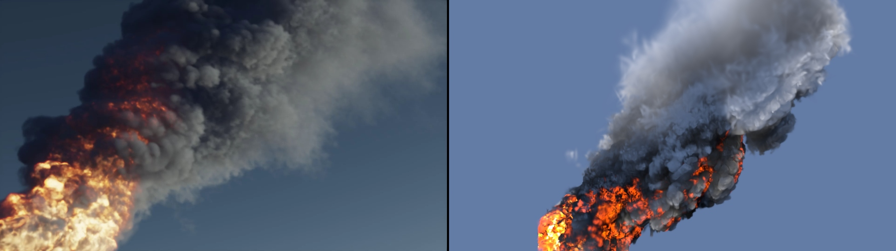
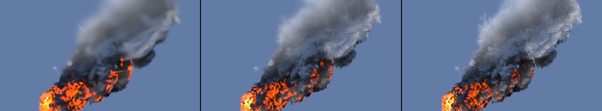
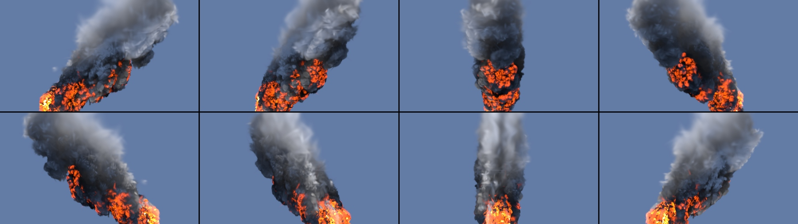

# Tutorial: a production fire simulation to USD 3D gaussians

[The first tutorial](vdb_to_usd.md) converts a small smoke volume. This one takes a heavy one all the way: JangaFX's
**Fire Plume**, an EmberGen simulation of 250 frames and 10 GB of OpenVDB, converted with athenea's `vdb2splat`, lit and
rendered. Every number and picture here was made on an Apple M5 Pro with athenea 0.5.0.



*Frame 120. Left: EmberGen's own render, from the video in the download. Right: the same frame as 200,000 volumetric
gaussians in a 13 MB USD file, drawn by athenea's raster. The two cameras and lights are not matched; the gaussians'
look is set by hand in step 3.*

## 1. Get the simulation

[JangaFX's free VDB animations](https://jangafx.com/software/embergen/download/free-vdb-animations) are CC0. Fire Plume
unpacks to `firePlume_0000.vdb` … `firePlume_0249.vdb`, about 40 MB a frame on disk, each with a `density` grid and a
temperature grid named `flames`.

## 2. Convert one frame

```sh
athenea vdb2splat firePlume_0120.vdb -n 50000 --temperature flames --device-mb 8192 \
  -o f0120_50000.usdc --back f0120_50000_back.vdb --measure
```

- `--temperature flames`: EmberGen names its temperature grid `flames`; without this the fire is not read.
- `--device-mb 8192`: a frame is 87 MB as NanoVDB, and the default 2 GB pool is too small for it.

The same frame at three budgets (`-n`):

| Gaussians | USD file | Density error (relative L2) | Transmittance error (4096 rays) | Fit |
|---|---|---|---|---|
| 10,000 | 0.66 MB | 0.209 | 0.0153 | 6.3 s |
| 50,000 | 3.3 MB | 0.140 | 0.0109 | 8.7 s |
| 200,000 | 13.2 MB | 0.082 | 0.0087 | 12.4 s |



*10,000, 50,000 and 200,000 gaussians, same camera and look. The shape and the fire are there at 10,000; the smoke's
billows sharpen with the budget.*

The transmittance error is what a renderer sees through the smoke, and it is small at every budget. The temperature
fits worse than the density (a density-weighted relative L2 of 0.69, 0.62 and 0.54): the flames are thin sheets, far
finer than the smoke. In the picture they still read as fire.

## 3. Light it

`vdb2splat` stores the grids' own numbers; the stage says what they mean. For this file:

```usda
#usda 1.0
(
    upAxis = "Y"
)
def DistantLight "Key"
{
    float inputs:intensity = 6
    bool inputs:normalize = 1
    float inputs:angle = 1
    color3f inputs:color = (1.0, 0.95, 0.88)
    double3 xformOp:rotateXYZ = (-35, -115, 0)
    uniform token[] xformOpOrder = ["xformOp:rotateXYZ"]
}
def DomeLight "Dome"
{
    float inputs:intensity = 0.5
    color3f inputs:color = (0.25, 0.4, 0.75)
}
def "Smoke" (
    prepend references = @./f0120_50000.usdc@</World/Splats>
)
{
    float primvars:athenea:densityScale = 3
    color3f primvars:athenea:albedo = (0.85, 0.85, 0.85)
    float primvars:athenea:volume:emissionScale = 60
    float primvars:athenea:volume:temperatureScale = 900
    float primvars:athenea:volume:temperatureOffset = 1250
}
```

- `densityScale`: density to extinction per world unit. The grid's voxel is 1 unit and the plume is some 600 units
  tall, so a small number is enough: at 20 the smoke is a black silhouette, at 0.3 a white mist, at 3 it has dark
  cores and lit billows.
- `temperatureScale` and `temperatureOffset`: kelvin = scale × the file's temperature + offset. EmberGen's `flames` is
  not in kelvin: here it runs from 0 to about 10, with most of the fire between 0.3 and 2. This mapping puts that at
  1500 to 3000 K, orange to yellow. With a lower offset the fire goes dull red.
- `emissionScale`: how bright the black body glows. 0 is no fire.

```sh
athenea stage plume.usda --eye -1300 150 -90 --target 0 150 -90 --up 0 1 0 --focal 50 \
  --size 1280x720 --technique raster -o plume.exr
```

The plume leans along Z, so the camera looks along X. **Use `--technique raster`**: athenea's raster draws a medium of
gaussians; its path tracer (`rt`) leaves them out and says so in a warning. `--frame-all` works too, but frames the
gaussians' whole box, where the plume is small.

`--turntable 8` writes eight views around `--target` from one load of the stage. At 960×540 and 50,000 gaussians a
view took 0.21 s, file written:



## 4. Convert the whole simulation

```sh
athenea vdb2splat "firePlume_####.vdb" --sequence --independent --frames 0 249 -n 20000 --temperature flames \
  --device-mb 8192 -o "seq/f_####.usdc"
```

- `-o` with a run of `#` writes one USD a frame.
- `--independent` fits every frame from scratch. **For this simulation it is the mode to use.** Without it each frame
  starts from the one before (the first tutorial's default, made for streaming), and here that came out worse on every
  count:

| 250 frames, 20,000 gaussians | `--independent` | Default (from the frame before) |
|---|---|---|
| Density error (mean relative L2) | 0.18 | 0.25 |
| Flicker `vdb2splat` reports (mean) | 0.65 | 0.89 to 0.90 |
| Fit, a frame | 6.6 s | 13 s |
| In the picture | sharp on every frame | blurred, with needle-shaped gaussians |

The default's numbers are from the 124 frames of its run that were logged (it ran in pieces). The whole simulation took
28 minutes of fitting with `--independent`.

| | OpenVDB | 20,000 gaussians (USD) |
|---|---|---|
| 250 frames | 10 GB | 315 MB |
| One frame | 40 MB | 1.3 MB |

## 5. Make the film

One stage a frame, the same look and camera, then ffmpeg:

```sh
for i in $(seq 0 249); do
  f=$(printf %04d $i)
  sed "s|f0120_50000.usdc|seq/f_$f.usdc|" plume.usda > frame.usda
  athenea stage frame.usda --eye -1300 150 -90 --target 0 150 -90 --up 0 1 0 --focal 50 \
    --size 1280x720 --technique raster -o film/f_$f.exr
  oiiotool film/f_$f.exr --ch R,G,B --colorconvert linear sRGB -d uint8 -o film/f_$f.png
done
ffmpeg -framerate 30 -i film/f_%04d.png -c:v libx264 -pix_fmt yuv420p -crf 18 fireplume_20k.mp4
```

The film of the 250 frames at 20,000 gaussians is 3.7 MB as H.264 at 1280×720; a frame renders in well under a second.
