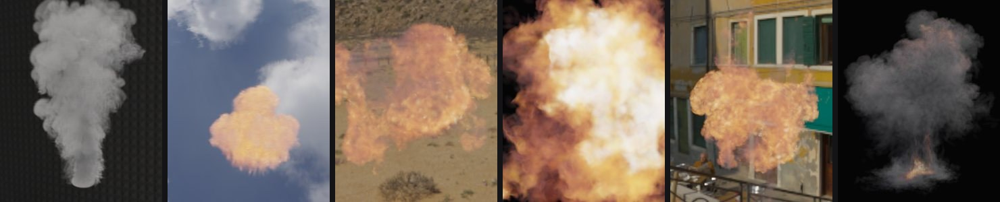
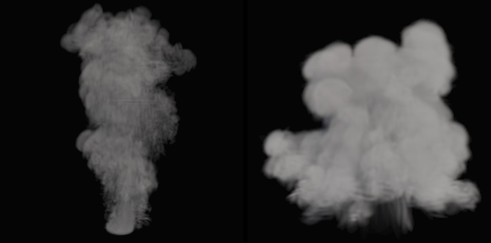

# Tutorial: an OpenVDB volume to USD 3D gaussians

Smoke, fire and clouds come out of simulation tools (Houdini, Blender Mantaflow, EmberGen) as OpenVDB volumes: a grid
of voxels per frame, tens of MB each. athenea's `vdb2splat` fits a few tens of thousands of **volumetric** gaussians to
that grid and writes them to OpenUSD as a `ParticleField`, the same kind of prim splat2mesh writes for objects. The
gaussians can also be turned back into a `.vdb`, so nothing is lost on the way to other tools.



*The six simulations on [athenea-vdb.lucab.co.uk](https://athenea-vdb.lucab.co.uk/), each one converted this way and
streamed to the browser: smoke column, fireball, gasoline, aerial, mid-air and ground explosions. EmberGen sample VDBs
by JangaFX (CC0); smoke column and fireball simulated with Blender Mantaflow.*

The difference from splat2mesh's own splats: Idol's gaussians are a **surface** (each one an opaque, coloured patch of
an object). `vdb2splat`'s gaussians are a **medium**: each one holds an extinction (how much light the smoke stops),
an albedo and, for fire, a temperature, and light goes through them.

## What you need

- athenea 0.5.0 or later ([releases](https://github.com/jesusluque/athenea/releases)): `athenea vdb2splat --help`
  lists the options. It is the binary splat2mesh renders with (`[athenea] bin` in `splat2mesh.toml`).
- A `.vdb` with a float **density** grid (a fog volume). A `temperature` grid and a `Cd` colour grid are read too
  when the file has them. Free samples: [JangaFX's EmberGen VDBs](https://jangafx.com/software/embergen/download/free-vdb-animations)
  and the OpenVDB samples (`smoke2.vdb`, `explosion.vdb`, `bunny_cloud.vdb`).

## 1. Convert

```sh
athenea vdb2splat smoke2.vdb -n 50000 -o smoke2_gs.usdc --back smoke2_back.vdb --measure
```

- `-n 50000`: at most 50,000 gaussians (default 20,000). More gaussians, finer wisps; fewer, smaller files.
- `-o smoke2_gs.usdc`: the gaussians as a USD stage (`.usda`, `.usdc` or `.usd`). Nothing is written without it.
- `--back smoke2_back.vdb`: also write the gaussians evaluated back on the input's own voxels, as a `.vdb`.
- `--measure`: print how close the result is (step 2).

The grids are found by name: `--density` (default `density`), `--temperature` (`temperature`) and `--colour` (`Cd`).
Use them when a file names its grids differently. A large volume (such as `bunny_cloud.vdb`) may need a bigger GPU
pool: `--device-mb 4096`.

The fit runs entirely on the GPU, in about half a second to a second per frame on an Apple M5 Pro (0.5 s for the smoke
column at 20,000 gaussians, 0.84 s for the fireball at 50,000).

## 2. Check the result

`--measure` prints:

- the **relative L2 error** of the density given back, over the active voxels, and the largest difference;
- the **transmittance** the gaussians give along `--rays` random rays (default 4096), against ratio tracking through
  the original grid: what a renderer would see through the smoke;
- with a temperature grid, the temperature's error too.

If the error is too high, raise `-n`, or give the fit more steps (`--iterations`, default 100). The full list of
options is in athenea's
[operations.md §2.8.3](https://github.com/jesusluque/athenea/blob/main/docs/operations.md#283-athenea-vdb2splat--a-volume-into-volumetric-gaussians-and-back).

## 3. What the USD holds

One `UsdVolParticleField3DGaussianSplat` prim: the standard positions, orientations, scales and `radiance:base`, in the
grid's own world units, plus:

| Primvar | Meaning |
|---|---|
| `primvars:athenea:splat:volume` | `true`: the gaussians are a medium, not a surface |
| `primvars:athenea:volume:sigma` | each gaussian's peak extinction, in the grid's density units |
| `primvars:athenea:volume:albedo` | the `Cd` colour (1 where the file has none) |
| `primvars:athenea:volume:temperature` | the temperature, where the file has one |

`radiance:base` holds the colour and, as opacity, how much the gaussian blocks through its middle. A standard 3DGS
viewer draws that. athenea draws the gaussians as a real medium instead, with the scene's lights and the smoke's own
shadow, and fire glowing from its temperature.

## 4. Render it with athenea

A volume is rendered from a small stage: the volume, its density scale and colour, and the lights. This is the stage
for the original grid:

```usda
#usda 1.0
(
    upAxis = "Y"
    metersPerUnit = 1
)
def Volume "Smoke"
{
    rel field:density = </Smoke/density>
    float primvars:athenea:densityScale = 40
    color3f primvars:athenea:albedo = (0.9, 0.9, 0.9)
    def OpenVDBAsset "density"
    {
        asset filePath = @./smoke2.vdb@
        token fieldName = "density"
    }
}
def DistantLight "Sun"
{
    float inputs:intensity = 4
    bool inputs:normalize = 1
    float inputs:angle = 0.53
    float3 xformOp:rotateXYZ = (-40, 35, 0)
    uniform token[] xformOpOrder = ["xformOp:rotateXYZ"]
}
def DomeLight "Sky"
{
    float inputs:intensity = 0.4
    color3f inputs:color = (0.55, 0.7, 1.0)
}
```

```sh
athenea stage smoke2.usda --eye 0 1 6 --target 0 1 0 --up 0 1 0 --focal 50 --size 1024x1024 \
  --technique rt --path-total 256 -o smoke2.exr
```

The camera values are an example: aim `--target` at the middle of your volume and set `--eye` far enough back to
frame it. To compare, point `filePath` at `smoke2_back.vdb` (the gaussians given back) and render again from the same camera.
To render the gaussians themselves, reference `smoke2_gs.usdc` in the stage in place of the `Volume`, with the same
lights: athenea draws a `ParticleField` marked `athenea:splat:volume` as a medium.

athenea's raster draws a medium of 50,000 gaussians in 18 ms, where the path tracer takes 13.5 s on the original grid
(Apple M5 Pro), within a relMSE of 0.025 of that path trace.



*The smoke column (left, 10,000 gaussians) and the fireball (right, 10,000 gaussians) in the WebGPU player of
[athenea-vdb.lucab.co.uk](https://athenea-vdb.lucab.co.uk/).*

## 5. Animated simulations

A simulation is a sequence of `.vdb` files, one per frame. Name them with a run of `#` and give the frames:

```sh
athenea vdb2splat plume_####.vdb --sequence --frames 1 90 -n 20000 -o plume_gs.usdc
```

Each frame after the first starts from the previous frame's gaussians, kept in the same slots and moved by the
simulation's velocity grid (`vel` by default, `--velocity` otherwise). Since the same gaussians live on from frame to
frame, the sequence does not flicker and a video codec can predict it, which is how the examples above stream:
from 24 to 136 Mbit/s.

- Mantaflow (Blender) stores its velocity in its own units: add `--velocity-units mantaflow --fps 24`.
- `--independent` fits every frame from scratch instead (more flicker).
- Each frame prints the gaussians alive, the density error, the fit's time and, from the second frame on, the
  flicker against the original.

## Why convert

From the published examples:

- **Small.** The smoke column's simulation cache is 2.5 MB per frame; its 20,000 gaussians stream at 0.28 MB per frame,
  10,000 at 0.14 MB. A still volume packs into 24 bytes per gaussian (`--quantise half`): 1.2 MB against 22.6 MB as a
  float NanoVDB grid.
- **Real time.** 18 ms against 13.5 s for the path trace of the grid, as above.
- **Both ways.** `--back` gives an OpenVDB grid again, for Houdini, Blender or any tool that reads VDB.
- **Open.** OpenVDB in, OpenUSD out; athenea is Apache-2.0.
