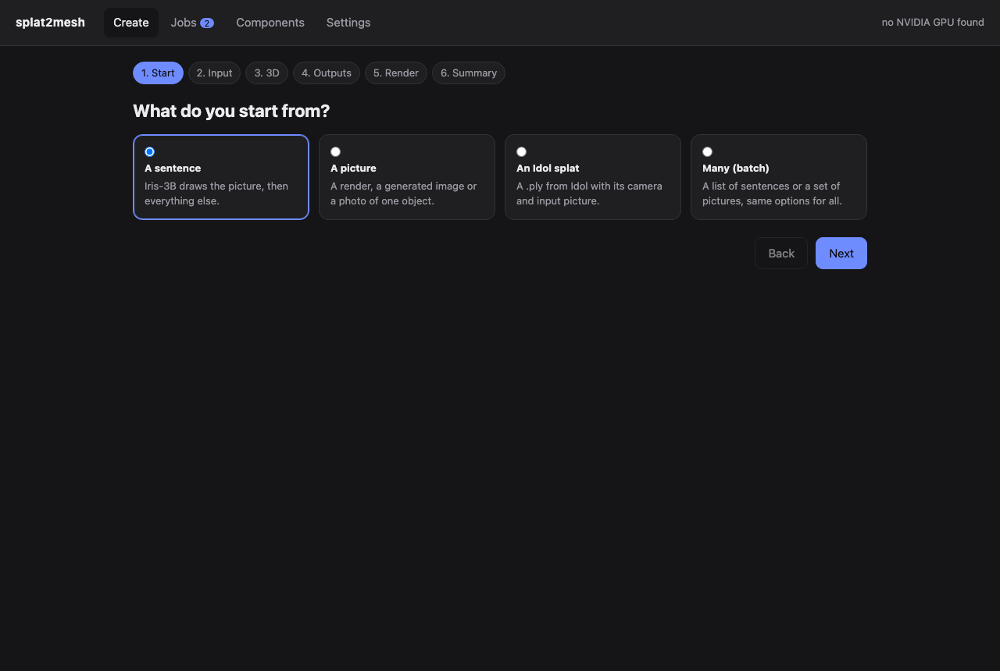

# Windows: everything on one PC

splat2mesh runs natively on Windows 10/11 with an NVIDIA GPU: no WSL, no remote hosts. An installer sets it up
and a local app drives it.

## What you need

| | Minimum | Comfortable |
|---|---|---|
| GPU | NVIDIA RTX, **8 GB** (developed on an RTX 3070) | 16 GB (Iris-3B fully on the GPU) |
| Driver | 570 or later (CUDA 12.8) | |
| RAM | 16 GB | 32 GB |
| Disk | ~45 GB for the components and models | plus room for results |
| Accounts | Hugging Face (Idol's DINOv3 encoder is gated: accept its terms first); a DeepSeek API key for the materials | |

What each part uses on the GPU, one at a time (the app runs one GPU job at a time):

| Component | GPU |
|---|---|
| Idol (picture → splat) | 7.2 GB peak |
| ENEAS (part masks) | fits in 8 GB |
| athenea (renders, turntables) | a few GB |
| Iris-3B Turbo (sentence → picture) | ~14 GB; on 8–15 GB GPUs its text encoder runs on the CPU (same picture, slower prompt) |

## Install

Run `splat2mesh-<version>-windows-setup.exe`. The wizard asks:

1. **Folder** — by default `%LOCALAPPDATA%\splat2mesh` (no administrator rights).
2. **Components** — *Everything*, *Everything except local Iris-3B* (8 GB GPUs; sentences go through the online
   Iris Space), *Renderer only*, or a custom choice.
3. **Idol's image encoder** — the FLUX.2 VAE from FLUX.2-klein-4B (Apache-2.0, the default) or from FLUX.2-dev
   (non-commercial licence). The weights are the same in bf16 ([licences](licenses.md)).
4. **Iris-3B** — local with the text encoder on the CPU, local all on the GPU, or the online Space. The wizard
   preselects from the GPU it finds.
5. **Keys** — a Hugging Face token, used for the DINOv3 download only and not stored; and the DeepSeek key, stored
   in `%APPDATA%\splat2mesh`.

The installer copies the code, then installs each component with its own progress bar:

| Step | What | Where |
|---|---|---|
| Core | uv, Python 3.12, splat2mesh's packages | `tools\uv`, `tools\python`, `.venv` |
| athenea | the published Windows release (exe, DLLs, shaders), checksum verified | `tools\athenea` |
| Idol | the Idol SDK, PyTorch (CUDA 12.8), its weights, DINOv3, the VAE | `tools\idol-sdk`, Hugging Face cache |
| ENEAS | ENEAS in its own environment (all its dependencies except `deepspeed`, which inference does not use); its weights (~9 GB) download on the first segmentation | `tools\eneas` |
| Iris-3B | Iris-3B Turbo and Qwen3-VL-4B | `tools\iris-3b`, Hugging Face cache |

Settings go to `%APPDATA%\splat2mesh\config.toml` (`python -m splat2mesh.config` prints what is resolved).

Unattended, or to repair: `installer\install_all.bat [klein|dev] [cpu-encoder|gpu|space]`, with `HF_TOKEN` and
`DEEPSEEK_API_KEY` in the environment if wanted. Each component can also be (re)installed from the app's
**Components** page or with `python -m splat2mesh.winsetup install idol` (and `status` to check).

## The app

Full guide with screenshots: [app.md](app.md).

Start menu → **splat2mesh** (or `installer\splat2mesh.bat`). A local server opens in its own window
(`http://127.0.0.1:8765`).

- **Create** — a six-step wizard:
  1. *Start*: a sentence, a picture, an Idol splat, or many (batch of sentences or pictures).
  2. *Input*: the sentence (with Iris-3B's seed, size and mode), the picture, or the splat with Idol's camera and
     input picture.
  3. *3D*: Idol's seeds (with more than one, each is rendered from four sides and scored by DeepSeek, and the best
     is kept) and the number of gaussians.
  4. *Outputs*: the relightable splat with materials (no geometry at any step), the mesh USD, PBR materials, mesh
     faces and texture size, parts by hand.
  5. *Render*: turntable frames, size, raster or path traced, light.
  6. *Summary*: what will run, an estimated time and warnings for anything missing.
- **Jobs** — the queue: one job at a time, a progress bar and the current stage each, the log, and the results
  (input, turntables, USD and PLY downloads, the result folder).
- **Components** — what is installed, the GPU, and install or reinstall buttons with progress.
- **Settings** — the DeepSeek key and the Iris-3B mode.

Results go to `work\jobs\<job>\out\`: `splat\splat.usdc` (relightable splat for athenea),
`splat\mat\splat_materials.ply` (the splat with its materials per gaussian), `mesh\00\usd\asset.usda` (mesh with
UVs, texture and materials), the turntables, and `results.json`.

## Limits on Windows

- The athenea release used (0.3.0) has no `splat-transfer`, so the refracting glass for the web is not made there;
  path traced renders (`technique rt`) refract with what it has.
- Idol runs without `torch.compile` on Windows (about 1.7 times slower sampling than on Linux).
- The first ENEAS segmentation downloads its weights (~9 GB).
